


<!--
--><!--
-->

 

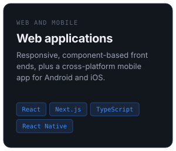<!--
-->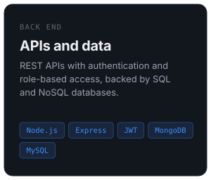<!--
-->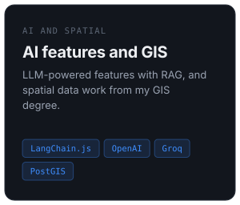

 

<a href="https://innerheal.live/">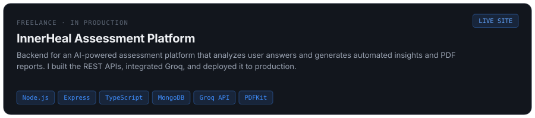</a>
<a href="https://github.com/3mrNour/InsightO">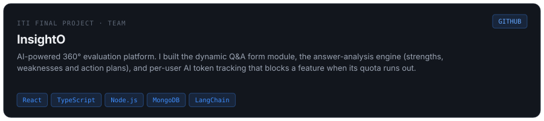</a>
<a href="https://github.com/Mohamedali22710/Delivery-mangment-system">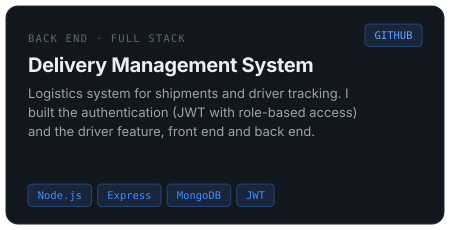</a><!--
--><a href="https://github.com/Mohamedali22710/aiCHatGpt">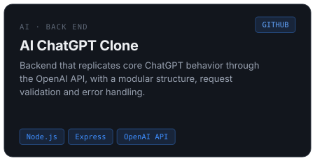</a>
<a href="https://github.com/Mohamedali22710/Bookapp">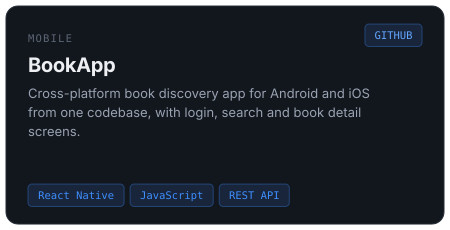</a><!--
--><a href="https://mohamedali22710.github.io/HeadPhoneStore/">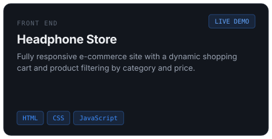</a>

 

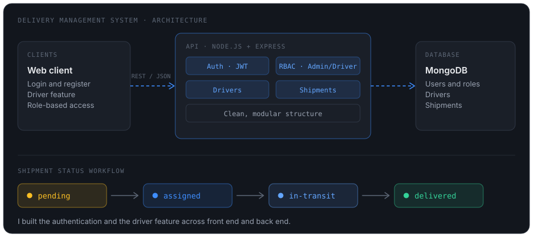

 

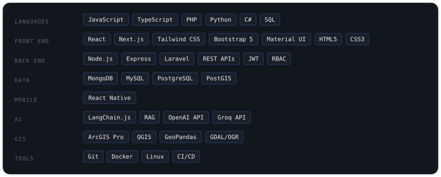

 

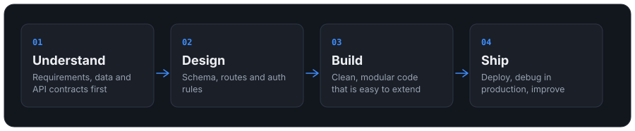

 


